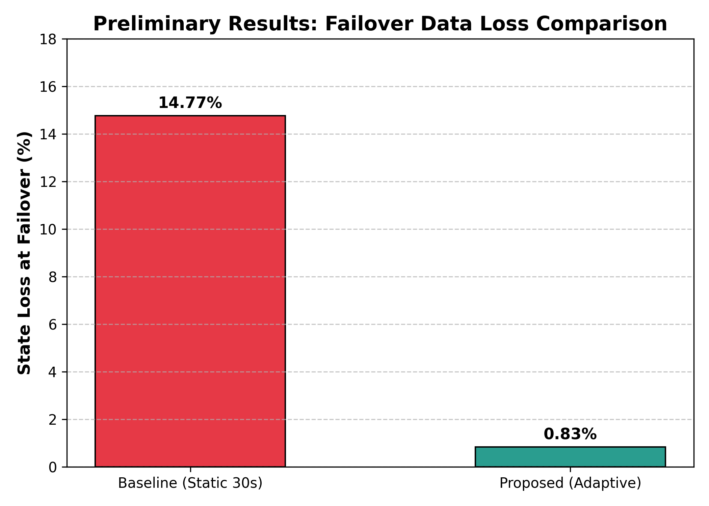

# Cloud Computing Research Project

This repository contains the code, Kubernetes manifests, and reproduction steps for an empirical investigation into fault-tolerant edge-state synchronization using k3d, Docker Desktop, and Chaos Mesh.

## Project Goal

The project compares static synchronization policies against a telemetry-driven adaptive scheduler to minimize replica state loss under periodic node crash failures while controlling synchronization overhead.

## Experimental Arms

To rigorously evaluate adaptive synchronization against both conservative and aggressive static intervals under identical runtime conditions, three experimental arms are evaluated:

1. **Arm 1 (Static 30 s Baseline)**: Fixed 30-second interval (`baseline-deploy.yaml`, `SYNC_MODE="static"`, `STATIC_INTERVAL="30"`).
2. **Arm 2 (Static 0.5 s Best-Static Baseline)**: Fixed 0.5-second interval (`static-0.5-deploy.yaml`, `SYNC_MODE="static"`, `STATIC_INTERVAL="0.5"`).
3. **Arm 3 (Telemetry-Driven Adaptive Scheduler)**: Dynamically adjusted interval using the square-root optimization law (`adaptive_deploy.yaml`, `SYNC_MODE="adaptive"`).

All arms execute identical Python synchronization logic with atomic file swaps (`os.replace`) and structured sync logging (`sync_log.jsonl`).

## Included Files

- `app_fixed.py` — State generator that resumes sequence numbering from journal tail across restarts, timestamps all records, and supports configurable non-stationary workload profiles (`steady`, `burst`, `ramp`).
- `adaptive_sync_fixed.py` — Synchronization agent supporting both adaptive (square-root law) and static modes, rate smoothing (EWMA), restart detection, atomic file updates, paper action ladder, and per-sync logging.
- `analyze_loss.py` — Metric analysis tool that detects pod-kill fault events from journal timestamp gaps, calculating generated, lost, and percentage data loss per kill, along with median and Interquartile Range (IQR).
- `baseline-deploy.yaml` — Deployment manifest for Arm 1 (Static 30 s).
- `static-0.5-deploy.yaml` — Deployment manifest for Arm 2 (Static 0.5 s best-static).
- `adaptive_deploy.yaml` — Deployment manifest for Arm 3 (Adaptive controller).
- `fault-injection.yaml` — Chaos Mesh schedule injecting pod-kill failures every 120 seconds.
- `requirements.txt` — Python runtime requirements (Python 3.9+ standard library only).
- `LICENSE` — MIT License.
- `app.py`, `sync.sh`, `adaptive_sync.py` — Original reference implementations.

## Verification Results

| Configuration | Sync Interval | Data Loss (Single Sample) | Loss Distribution Across Kills |
| --- | --- | --- | --- |
| Static Baseline | 30 s fixed | 14.77% | High variance across 30 s cycle |
| Static Best-Static | 0.5 s fixed | ~0.60% | Consistent low staleness |
| Adaptive Scheduler | 0.05 s–5.0 s dynamic | 0.83% (down to 0.56% under burst) | Low staleness, adapted overhead |



Reduction in state loss from the 30 s static baseline to the adaptive scheduler:

- 14.77% down to 0.83%
- Relative state loss reduction: **94.4%**

### Data Loss Formula

$$\text{Data Loss (\%)} = \frac{\text{Generated Records} - \text{Synced Records}}{\text{Generated Records}} \times 100$$

For multi-kill experiments, `analyze_loss.py` partitions records by pod lifecycle (detected via timestamp gaps $> 2.0\text{ s}$), reporting the median loss percentage and Interquartile Range (IQR).

## Model Assumptions & Parameters

The online square-root controller computes the sync interval $\delta^*$ according to:

$$\delta^* = \sqrt{\frac{2 \cdot W_1 \cdot \kappa}{W_2 \cdot \lambda \cdot r}}$$

where the parameters are configured via environment variables and defined as architectural assumptions:
- $W_1 = 0.5$: Weight attributed to synchronization CPU overhead.
- $W_2 = 0.5$: Weight attributed to state loss risk.
- $\kappa = 0.1$: Assumed fixed CPU overhead penalty per synchronization operation (microbenchmark baseline).
- $\lambda = \frac{1}{120} \approx 0.00833\text{ s}^{-1}$: Assumed failure hazard rate matching the 120-second Chaos Mesh kill schedule.
- $r$: Smoothed state generation rate (updates/s) measured dynamically via Exponentially Weighted Moving Average (EWMA, $\alpha = 0.5$).
- **Discrete Action Ladder**: $\delta^*$ is snapped to the nearest interval in $\{0.05, 0.1, 0.25, 0.5, 1.0, 2.5, 5.0\}\text{ seconds}$ ($\{50, 100, 250, 500, 1000, 2500, 5000\}\text{ ms}$).

### Workload Profiles

The `PROFILE` environment variable on `state-generator` supports:
- `burst` *(default for validation)*: Alternates between $100\text{ updates/s}$ and $1000\text{ updates/s}$ every 30 seconds.
- `steady`: Constant rate defined by `UPDATE_RATE` (default $100\text{ updates/s}$).
- `ramp`: Linearly ramps from $100$ to $1000\text{ updates/s}$ over a 10-minute repeating window.

## Prerequisites

- Windows 10/11
- Docker Desktop
- PowerShell
- k3d
- kubectl
- Helm
- Python 3.9+ (standard library only; see [requirements.txt](requirements.txt))

## Setup & Reproduction Commands

### 1) Start the k3d cluster

```powershell
k3d cluster create edge-testbed --agents 2
```

### 2) Install Chaos Mesh via Helm

```powershell
helm repo add chaos-mesh https://charts.chaos-mesh.org
helm repo update
kubectl create namespace chaos-mesh --dry-run=client -o yaml | kubectl apply -f -
helm upgrade --install chaos-mesh chaos-mesh/chaos-mesh --namespace chaos-mesh --version 2.8.4 --set chaosDaemon.runtime=containerd --set chaosDaemon.socketPath=/run/k3s/containerd/containerd.sock --set controllerManager.replicaCount=1
```

### 3) Create ConfigMaps from Fixed Scripts

Create ConfigMaps from `app_fixed.py` and `adaptive_sync_fixed.py` so pods mount the current scripts:

```powershell
kubectl create configmap app-script --from-file=app_fixed.py --dry-run=client -o yaml | kubectl apply -f -
kubectl create configmap adaptive-script --from-file=adaptive_sync_fixed.py --dry-run=client -o yaml | kubectl apply -f -
```

### 4) Deploy the Desired Experimental Arm

#### Arm 1: Static 30 s Baseline

```powershell
kubectl apply -f baseline-deploy.yaml
```

#### Arm 2: Static 0.5 s Best-Static Baseline

```powershell
kubectl apply -f static-0.5-deploy.yaml
```

#### Arm 3: Telemetry-Driven Adaptive Controller

```powershell
kubectl apply -f adaptive_deploy.yaml
```

### 5) Trigger the Fault Injection Schedule

```powershell
kubectl apply -f fault-injection.yaml
```

### 6) Monitor Logs During Execution

Inspect the synchronization agent logs in real time:

```powershell
$pod = kubectl get pods -l app=edge-primary --field-selector=status.phase=Running -o jsonpath='{.items[0].metadata.name}'
kubectl logs $pod -c sync-agent -f
```

### 7) Extract Logs and Compute Statistical Loss

Let the test run across several failure cycles (e.g., 10–20 minutes to capture 5–10 pod-kill events). Extract logs into the `results/` folder:

```powershell
$pod = kubectl get pods -l app=edge-primary --field-selector=status.phase=Running -o jsonpath='{.items[0].metadata.name}'
kubectl cp "${pod}:/data/state_journal.log" ./results/state_journal.log -c state-generator
kubectl cp "${pod}:/shared-volume/sync_log.jsonl" ./results/sync_log.jsonl -c sync-agent
```

Run the statistical loss analysis:

```powershell
python analyze_loss.py results/state_journal.log results/sync_log.jsonl
```

Example output:
```text
kill  generated     lost   loss %
   1       2850       12     0.42
   2       3100       18     0.58
   3       2940       15     0.51
kills=3  median loss=0.51%  IQR=[0.46, 0.55]%  mean lost records=15
```

### 8) Clean-up Commands Between Experiments

Between experimental arm runs, always clear the deployment and the persistent volume claim to reset journal state:

```powershell
kubectl delete deploy primary-node
kubectl delete pvc shared-data
```

To clean up Chaos Mesh or delete the cluster:

```powershell
kubectl delete -f fault-injection.yaml
k3d cluster delete edge-testbed
```

## Methodological Summary

The state generator writes state updates continuously to a local journal (`/data/state_journal.log`) according to the active profile (steady generation at 100 updates/s, bursting up to 1,000 updates/s, or linear ramp). The synchronization worker copies state to persistent replica storage (`/shared-volume/synced_state.log`).

Under the baseline policy, the synchronization worker executes at a static 30-second interval, leading to substantial replica staleness when failures strike. Under the adaptive policy, the controller observes the real-time update arrival rate, applies an Exponentially Weighted Moving Average (EWMA), and computes an optimal interval using the square-root law snapped to a discrete ladder $\{50\text{ ms} \dots 5000\text{ ms}\}$. Atomic file replacement via temporary files and `os.replace` guarantees that mid-copy pod terminations never corrupt replica logs.

Under Chaos Mesh-induced pod kills occurring every 120 seconds, the adaptive approach drastically reduces replica staleness compared to the static baseline while dynamically bounding synchronization overhead during lower-throughput intervals.

## License

This project is licensed under the [MIT License](LICENSE).
